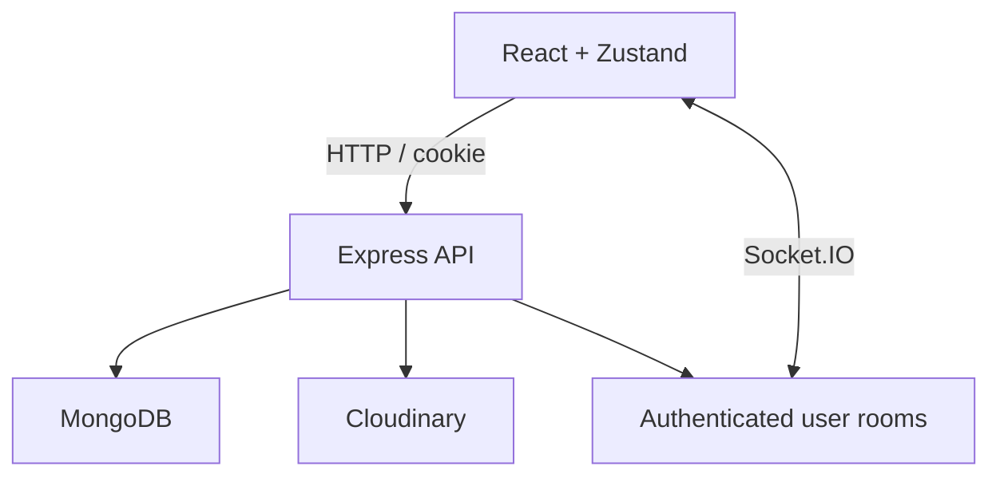

# CapiChat

**A browser chat prototype with private conversations, image messages, and online presence.**

This learning project combines a React interface with an Express/MongoDB API and Socket.IO. HTTP persists messages; realtime events deliver newly saved messages to connected recipients.

**React · Zustand · Express · MongoDB · Socket.IO · Cloudinary**

## Product flow

| Action | Implementation |
| --- | --- |
| Register / sign in | Password authentication and JWT in an HTTP-only cookie |
| Select a conversation | Load messages between the signed-in user and selected recipient |
| Send text or image | Save the message; upload images through Cloudinary |
| Receive live messages | Authenticate the socket using the signed cookie and deliver to a user room |
| Open multiple tabs | Each tab joins the same user room; presence tracks connection count |

## Architecture and review points



- [Socket server](backend/src/lib/socket.js): derives identity from a verified cookie, not an untrusted userId query string.
- [Message controller](backend/src/controllers/message.controller.js): persistence precedes event delivery.
- [Chat store](frontend/src/store/useChatStore.jsx): accepts events only for the selected sender and appends against current state.
- [Auth store](frontend/src/store/useAuthStore.jsx): restores the socket after refreshing a signed-in page.

## Run locally

Use Node.js/npm, MongoDB, and a Cloudinary account for image features.

```bash
git clone https://github.com/joaovitormessias/chat-real-time.git
cd chat-real-time
npm ci --prefix backend
npm ci --prefix frontend
cp backend/.env.example backend/.env
```

Edit `backend/.env` with your MongoDB URL, a random JWT secret, and Cloudinary configuration. Keep `NODE_ENV=development` for local HTTP cookies. Run each command from the repository root in a separate terminal:

```bash
npm run dev --prefix backend
npm run dev --prefix frontend
```

Open http://localhost:5173; the API defaults in the example to port 5001. Do not commit `.env`.

## Verify

After installing both dependency sets:

```bash
node --test backend/tests/socket.test.js
node --experimental-vm-modules --test frontend/tests/chat-store.test.cjs
npm run build --prefix frontend
npm run lint --prefix frontend
```

Socket tests use a mocked user lookup and real local socket connections: a forged query identity is rejected and authenticated multiple tabs receive delivery. They do not exercise MongoDB or Cloudinary. Three store tests exercise sender filtering, pending-send preservation and stale responses after changing conversations. They load the real store module with mocked HTTP/socket dependencies and Zustand. The frontend build verifies bundling, not a complete browser journey. The frontend build and lint pass in the review environment.

For manual evaluation, use two synthetic accounts in separate browser sessions: exchange text, upload an image, refresh, open another tab, and confirm messages stay in the correct conversation.

## Current limits

No message-delivery acknowledgement/replay protocol, pagination, upload quota, production session revocation, or multi-server socket adapter is implemented. Presence is process-local. Dependencies are older and need a separate compatibility/security update. A working local socket test does not establish production readiness.

[Maintainer](https://github.com/joaovitormessias)
